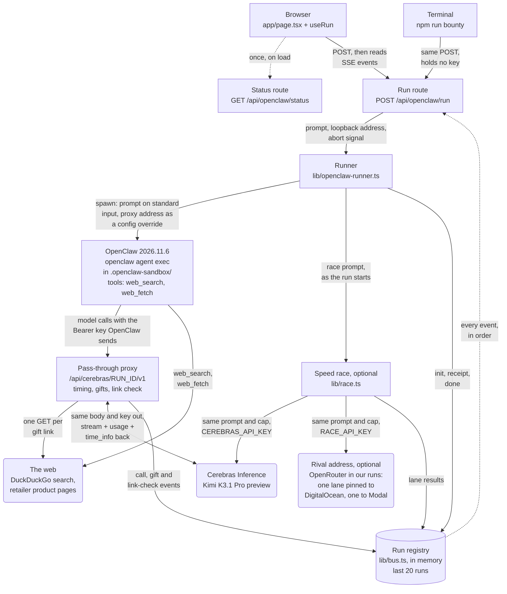
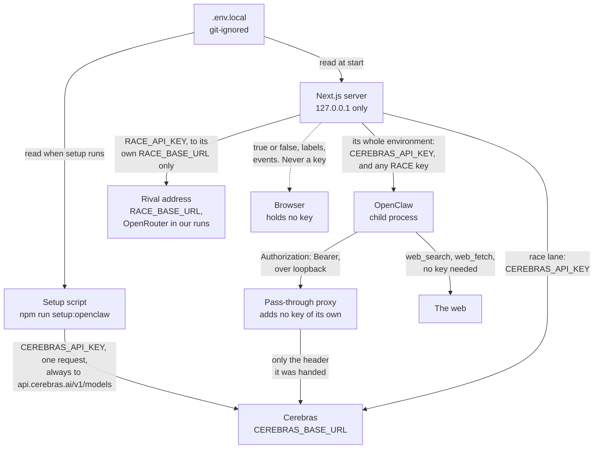
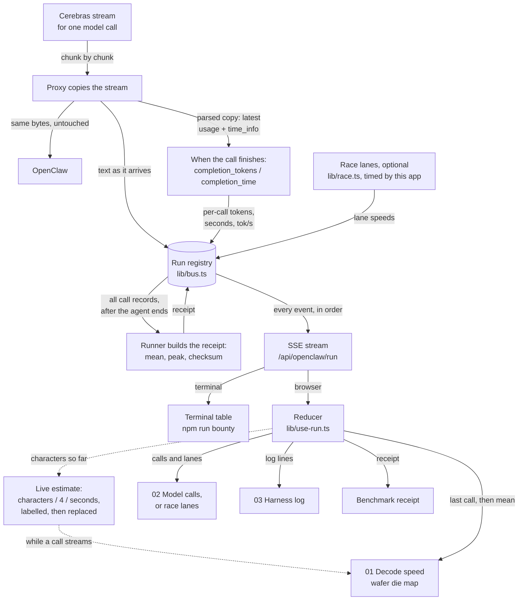
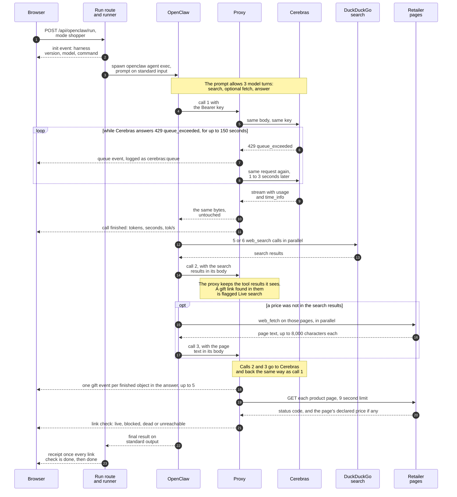
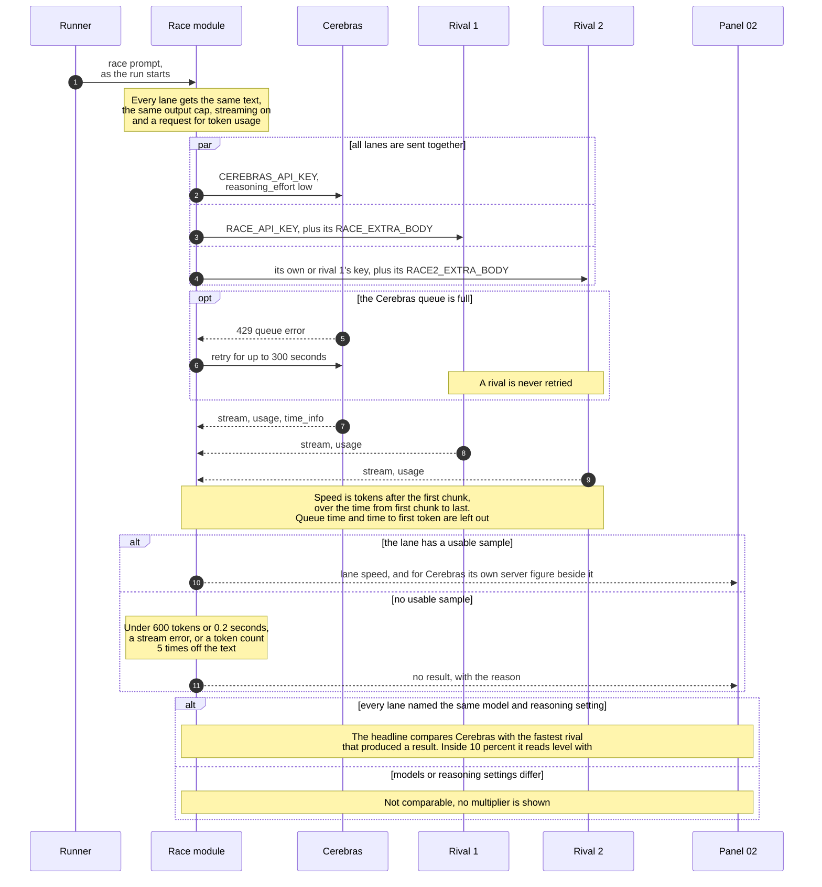
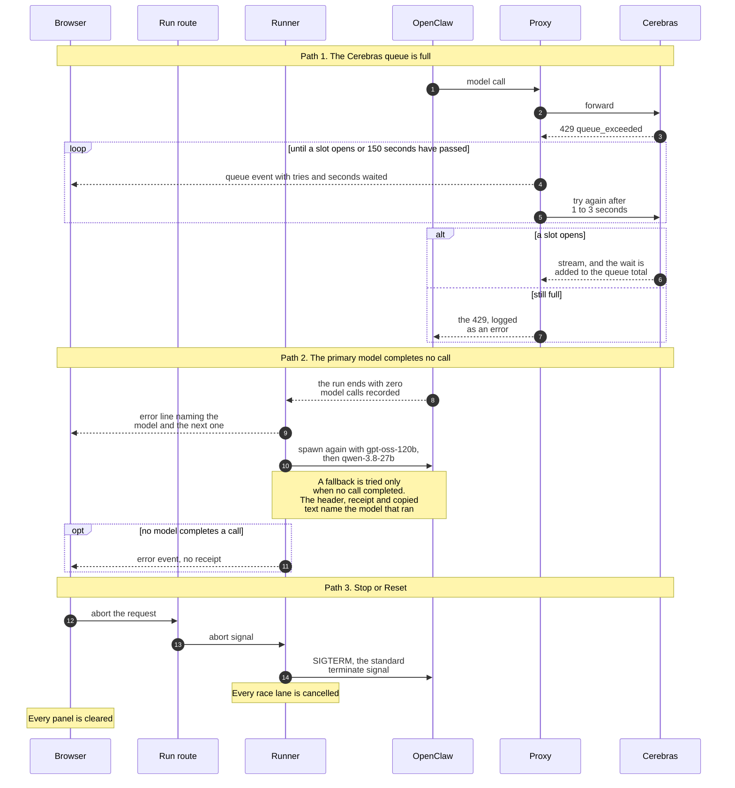
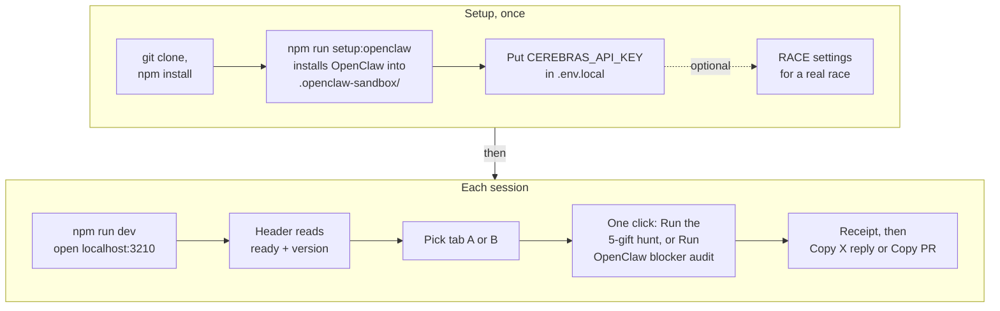

# WaferClaw

**WaferClaw is a local dashboard that runs the real OpenClaw agent harness on Kimi K3.1 Pro at Cerebras and shows, for every model call, the decode speed worked out from the token count and decode time that Cerebras itself reports.**

Every run starts a real `openclaw agent exec` process (OpenClaw is an agent harness: the program that lets a language model call tools in a loop). The agent's model calls pass through one route in this app on their way to Cerebras Inference (Cerebras's hosted application programming interface, or API, for running models), and that route reads the `usage` and `time_info` fields Cerebras attaches to each answer.

Everything is judged by one number: **decode speed in tokens per second (tok/s), `completion_tokens / completion_time`, both taken from what Cerebras reports for each model call.** A token is a word piece, and decode speed is how fast the model writes once it has started. The receipt prints wall time and, within it, the seconds spent in Cerebras's queue. Time on the network or inside a tool appears only as part of wall time, and none of it is counted in the decode speed.

Built for the Cerebras x Moonshot AI Kimi K3.1 Pro x OpenClaw Weekend Hackathon (21 to 22 November 2026) · **Independent entry, not affiliated with Cerebras, Moonshot AI or OpenClaw** · App: none hosted, it runs locally at `http://localhost:3210` · Demo: the submission post on X (link to follow) · Code: [github.com/mrnetwork0001/WaferClaw](https://github.com/mrnetwork0001/WaferClaw)

**Judges, start here:** watch the demo video in the submission post on X (link to follow). There is no zero-setup path, because every run makes real calls. To see it work yourself you need your own Cerebras key with access to the preview model, and the steps in [Run it locally](#run-it-locally): clone, `npm install`, `npm run setup:openclaw`, put your key in `.env.local`, `npm run dev`. Then open `http://localhost:3210` and press **Run the 5-gift hunt**. Setup details are in [OPENCLAW_SETUP.md](OPENCLAW_SETUP.md), and the measured numbers from 22 November 2026 are under [One real run, end to end](#one-real-run-end-to-end).

---

## One speed readout, two modes and one race, no login needed

There is one page, no login, no wallet and no database. Everything below is a panel or a button on that page, `http://localhost:3210/`. A run needs your own Cerebras key in `.env.local`.

| Feature | What it is | Try it without a login |
| --- | --- | --- |
| **Decode speed** | Panel **01 Decode speed** draws speed on a wafer die map: a 19 by 19 grid of square dies clipped to a disc, lit from the centre outwards. A fully lit wafer means 2,500 tok/s (`FULL_WAFER_TPS`, where TPS is tokens per second: a display scale, not a claim). The die map is a gauge drawn by this app; no die stands for anything in Cerebras's hardware. On 22 November 2026 the measured means on the loaded preview endpoint (316 to 507 tok/s) lit between an eighth and a fifth of it. The big number always says where it comes from: *Live estimate. Final figure comes from Cerebras* while a call streams, *Last model call, reported by Cerebras* between calls, and *Mean decode speed, reported by Cerebras* at the end. Four cells show Peak, 1st token, Decode seconds and Tokens. The wait is shown, and it is never counted as speed. | Start any run and watch the badge move through `BOOT`, `DECODING`, `RUNNING` and `FINAL`. `QUEUED` appears when Cerebras's queue is full before the first call has finished. |
| **Santa's Speedy Shopper** | Tab **A**. The prompt asks the agent to finish in 3 model turns: 5 or 6 `web_search` calls in parallel, an optional parallel `web_fetch` for prices it did not see, then the answer. Nothing in the app enforces that count; both reported shopper runs took 3 model calls and 10 tool calls. Up to 5 gift rows appear, each as soon as it finishes streaming. A row has the product name, a one-line reason, the retailer, a clickable product link, a **Live search** flag (the link's text appears in the web results the agent received) or **Not in search**, and a page check named after the Hypertext Transfer Protocol (HTTP) status code the store sent back: **Page 200** (it answered), **Bot-walled** (status 401, 403 or 429), **Missing 404** (or 410), **No reply**, or the bare status such as **HTTP 503**. Each price is tagged `agent-read`, `page-read` or `agent-stated`, or `see page` when there is none. No product list is hard-coded. The prompt names six retailer sites as examples of where to look (apple.com, bestbuy.com, amazon.com, bhphotovideo.com, target.com, lego.com) and names no product. If the agent returns fewer than 5 the page says so and fills nothing in. | Press **Run the 5-gift hunt**. Or press **@andrewdfeldman** or **@Kimi_Moonshot**. Or type in the field *@handle, or who it is for* and press **Hunt**. |
| **Cross-Team Blocker & PR Solver** | Tab **B** (PR means pull request, a proposed code change). Three sources each hold part of one incident: a GitHub issue with two files (Engineering, shown as `ENG`), a Slack thread (Support, `SUP`) and an architecture document (Product, `PRD`). The built-in incident is fictional and the panel labels it *fictional sample input*. The prompt tells the model not to call tools and asks for exactly 2 blockers that sit between teams, each with a root cause and quoted evidence, one next step per team, and a draft pull request whose diff streams in line by line. Nothing is opened on GitHub: **Copy PR** copies the title, body and diff as text. | Open tab **B** and press **Run OpenClaw blocker audit**. Or press **Paste your own**, paste up to 12,000 characters, and press **Run audit on your pasted material**. |
| **Same request, N providers** | Panel **02**, optional. When rival settings exist in `.env.local`, one request with the same text and the same output cap (1,500 tokens by default) is sent to Cerebras and to up to 3 rival providers as the run starts. In our runs the rivals were two GPU clouds, DigitalOcean and Modal, reached through OpenRouter. GPU is short for graphics processing unit, and DigitalOcean does not publish which chip it uses for this model. Each lane uses its provider's own name for the model, the Cerebras lane adds `reasoning_effort: low`, and a rival lane adds whatever its `RACE_EXTRA_BODY` holds. This app times every stream the same way: tokens after the first chunk, over the time from first chunk to last. The headline compares Cerebras with the fastest rival that produced a result and lists a multiplier for each slower one beneath. It calls anything within 10% *level with*, and it is replaced by *different models · not comparable* or *different reasoning settings · not comparable* when the lanes do not match (the reasoning setting is how much thinking a request asks the model to do before it answers). Without rival settings the panel is titled **Model calls, this run** and shows the last 4 calls of this run. With no rival key there is no race, and no stand-in bar. | Uncomment the `RACE_*` lines that `.env.example` puts in `.env.local`, add the rival's key (see the [variable table](#run-it-locally)), restart the server and run either mode. |

### More to explore

| Feature | What it is | Where |
| --- | --- | --- |
| **Run strip** | A numbered row of stages under the header: Harness boot, Web search, Cerebras queue, Kimi decode, Link check, Receipt (5 stages in blocker mode, with Draft PR instead of Web search and Link check). A stage is marked done only if it happened on this run. It ends in a clock and one button that reads **Stop** during a run and **Reset** after it. | `components/RunPipeline.tsx` |
| **Harness log** | Panel **03**: seconds since the run started, a tag and the text. Tags are `openclaw:init`, `openclaw:tool`, `openclaw:stream`, `openclaw:receipt`, `cerebras:queue`, `race` and `error`. It keeps the last 300 lines and prints the short form of the OpenClaw command the run used. | `components/OpenClawTerminal.tsx` |
| **Benchmark receipt** | A bone-coloured ticket at the bottom of the shopper panel: mean decode speed, model, harness version, gifts (*X of Y URLs from live search · Z pages confirmed live*, where a URL, or uniform resource locator, is a web address), tokens and decode seconds, wall time with the part spent in Cerebras's queue, the run id and a SHA-256 (Secure Hash Algorithm, 256-bit) checksum of the receipt's own fields. The blocker ticket is smaller: wall time, queue seconds, mean tok/s, tokens and model. | `components/SantaShopperArena.tsx`, `components/BlockerSolverArena.tsx` |
| **Copy X reply** | Copies a ready-made post for X (formerly Twitter): the model that ran, mean and peak tok/s marked *(server-side decode)*, and one numbered line per gift with its link. It names Kimi K3.1 Pro only when the model that ran contains `kimi`. Nothing is posted for you. The text carries no date and does not say the figures came from a loaded preview endpoint. Add both by hand before posting. | Shopper receipt |
| **Terminal run** | The same shopper run from a terminal, printed as a plain-text table (gift, price, retailer, from search, link) followed by the receipt and, when a rival is configured, the race lanes. It talks to the running server and holds no key. Despite the script's name this is not the Speed Bounty entry. It runs standard OpenClaw through the app, and no figure from the app is submitted for the bounty. | `npm run bounty`, `scripts/benchmark-shopper.mjs` |
| **Status check** | One request that says whether OpenClaw is installed, whether a key is present (true or false, never the key), which model and fallbacks are configured, and which race lanes exist. The header reads it once when the page loads. | `GET /api/openclaw/status` |
| **Isolated OpenClaw** | A wrapper that runs the project's own OpenClaw with its home, state, config and workspace inside `.openclaw-sandbox/`. | `scripts/oc --version` |
| **Speed Bounty chat** | A second, patched OpenClaw build with its own web chat, used only for the hackathon's Speed Bounty entry, a separate video posted in the event's Discord. It is not part of the app and does not appear in the public demo video. See [Deploying](#deploying-local-by-design). | `scripts/bounty-gateway.sh` |

**The header** has the WaferClaw mark (a wafer disc cut by three claw marks), the two tabs **A Santa's Speedy Shopper** and **B Cross-Team Blocker & PR Solver**, and two status cells. **OpenClaw harness** reads *ready* plus the installed version, *no API key*, or *not installed*. **Model · Cerebras** shows the configured model, or the model of the current run, so a fallback model is visible there.

**The layout** is one screen designed for 1440 by 900 pixels. On wide windows the left 5 of 12 columns hold panels 01 to 03 and the right 7 hold the active mode as panel 04. Narrower windows stack everything in one column. There is no separate phone layout.

**The look** is described in [DESIGN.md](DESIGN.md) as a "fab instrument": warm carbon background (`#0A0908`), bone text (`#ECE5D5`), one orange accent (`#FF5A1F`), lime and red only as pass and fail marks, hairline panels with orange corner marks, and three typefaces (Barlow Condensed for numerals, Archivo for prose, Martian Mono for labels). Animations switch off when the operating system asks for reduced motion.

**What is not there:** no login, no onboarding walkthrough, no sound, no light theme, no run history and no docs site. A page reload, **Stop** or **Reset** clears the board.

## Why the real harness and Cerebras's own timing are essential

Take either one away and the product has nothing to show.

- **No harness, no agent.** `lib/openclaw-runner.ts` spawns `openclaw agent exec` from the project's own install for every run. If it is missing, the run stops with `OpenClaw is not installed in .openclaw-sandbox (run: npm run setup:openclaw).` The app has no agent loop of its own: the searching, fetching and answering are all OpenClaw's.
- **No proxy, no numbers.** For one run, OpenClaw's Cerebras address is pointed at `app/api/cerebras/[runId]/v1/[...path]/route.ts`. That route is the only place the agent's `usage` and `time_info` are read. The race module (`lib/race.ts`) reads the same fields for its own separate requests. A run that ends with no model call recorded by the proxy gets an error and no receipt.
- **No `time_info`, no speed.** Per-call speed is `completion_tokens / completion_time`. If Cerebras sends no `completion_time`, the route reports 0 and does not fall back to a stopwatch. That call's tokens would still enter the run's mean with no seconds added, which would overstate the mean. The app has no guard against this. Queue time (Cerebras's `queue_time` plus any retry waits) is added up separately and printed on the receipt.
- **No search result, no "Live search" flag.** `urlWasSourced` in `lib/gifts.ts` marks a link as sourced only when its text appears in the tool results the agent received. A link the model wrote from memory is shown in red as **Not in search**.
- **No rival key, no race.** `lib/race.ts` returns no lanes unless rival 1 has a base address, a model and a key. There is no modelled baseline anywhere in the code to stand in for a missing measurement.

## Architecture

WaferClaw has four layers, all on one machine except the last:

- **The page:** one React page (`app/page.tsx`) and one hook (`lib/use-run.ts`) that turns a stream of Server-Sent Events (SSE, a one-way stream from server to browser) into what the panels show.
- **The app server:** a Next.js server bound to `127.0.0.1:3210` (loopback, the address a machine uses to reach itself, so no other device can connect), with a run route, a pass-through proxy route, a status route and an in-memory run registry (`lib/bus.ts`).
- **The harness:** an OpenClaw child process started per run from `.openclaw-sandbox/`, allowed two tools, `web_search` and `web_fetch`.
- **Outside services:** Cerebras Inference for the model, web search and retailer pages for the shopper, and, only when configured, a rival address for the race.

The diagrams below are Mermaid, which GitHub draws in the page.

### System overview



**One run, one stream.** The browser sends one `POST /api/openclaw/run` and reads the answer as an SSE stream. The terminal script sends the same request. The proxy, the runner and the race all report into the run registry, and the run route relays those events in order. Rounded boxes are outside this machine; everything else runs on it.

**State.** The app itself writes nothing to disk; OpenClaw keeps its own database and logs under `.openclaw-sandbox/state/`. Runs live in a map in the server's memory, the oldest is dropped once more than 20 exist, and a restart loses them all.

**Why the proxy is on loopback.** OpenClaw is told, for one run only, that its Cerebras address is `http://127.0.0.1:3210/api/cerebras/RUN_ID/v1`. The proxy passes each request body on unchanged and streams the answer body back byte for byte, keeping a parsed copy for the panels. It differs from a direct connection in two ways. When Cerebras answers `429` with a queue error, the proxy waits and retries for up to 150 seconds before the agent sees anything. And it carries few headers: of the request headers it forwards only `Authorization` (it sets `content-type` itself), and of the response headers it passes back only `content-type`. The app sees the timing without asking the agent for it.

### Who holds which key



| Key or actor | Lives in or holds | Can | Can never |
| --- | --- | --- | --- |
| `CEREBRAS_API_KEY` | `.env.local` (git-ignored; created with owner-only permissions by setup), the server process, and the OpenClaw child's environment | Pay for the agent's model calls and for the Cerebras race lane. Setup also uses it once to list the models it can reach. | Reach the browser: the status route returns only `keyPresent`. Be added by the proxy to a request that arrived without one. It is sent to whatever `CEREBRAS_BASE_URL` names, so changing that variable changes where the key goes. |
| `RACE_API_KEY`, `RACE2_API_KEY`, `RACE3_API_KEY` | `.env.local` and the server process. The OpenClaw child inherits the server's environment, so it can see them, though it has no use for them. | Pay for one streaming request per lane per run | Be sent to a base address other than the one it was set for: a rival with a different `RACE2_BASE_URL` must bring its own key or its lane fails. Reach the browser: the page gets labels, model names and notes only. |
| The browser | Holds nothing | Start a run from the app's own page, read its events, stop it | Read a key, a rival's address or a rival's extra request body |
| The terminal script | Holds nothing | Start a shopper run on the local server and print the result | Call Cerebras or OpenClaw itself |
| The agent (OpenClaw child) | `.openclaw-sandbox/` | Call the model, `web_search` and `web_fetch` | Run commands or touch files: the allow-list that setup copies from `openclaw.config.json5` names only the two web tools. OpenClaw enforces that list; no test in this repository checks it. |
| The hand-run wrappers (`scripts/oc`, `scripts/oc-bounty`) and the setup script (`scripts/setup-openclaw.sh`) | Each reads `.env.local` and exports every variable in it, Cerebras and rival keys alike, to the process it starts. That includes the patched Speed Bounty gateway, which keeps running in the background until you stop it. | Run OpenClaw outside the app. Setup also sends the Cerebras key once to `https://api.cerebras.ai/v1/models` to list models, whatever `CEREBRAS_BASE_URL` says. | Be timed, logged or limited by the app: nothing in this repository routes these processes through the proxy. Where the patched build sends the key is set by its own config under the git-ignored `.openclaw-sandbox/bounty/`, which was not checked for this README. |

The server binds to `127.0.0.1` in both `npm run dev` and `npm start`, so the page and all three routes are reachable only from the same machine. That binding is the real access boundary: the routes themselves have no login.

### How a number gets on screen



**Per call.** Speed is Cerebras's `completion_tokens` divided by its `completion_time`, taken when the call finishes. **Mean** on the receipt is all completion tokens of the run divided by all decode seconds. **Peak** is the fastest single call. Race lane speeds take a separate path: `lib/race.ts` times its own streams and never passes through the proxy.

**First token.** The cell marked *1st token\** is the one figure this app times itself: the moment the first piece of the answer reaches the proxy, minus the moment the request was sent, minus the queue time Cerebras reports, for the first call only. The note under the cells says so.

**The live number.** While a call is still streaming, Cerebras has not reported anything yet, so the page shows an estimate: characters received, divided by 4, divided by seconds since the first token. It is labelled *Live estimate* and is replaced by the server's figure when the call ends.

### One shopper run, end to end



Events are drawn as going straight to the browser for readability; in the code they pass through the run registry and the run route's stream. The agent's links are checked by the app, not by the agent: `checkLink` in `lib/gifts.ts` sends one GET request (a plain page fetch) per link with a browser-like user agent. A store that answers 401, 403 or 429 is shown as **Bot-walled**, a 404 or 410 as **Missing**, any other error status as its code, and no answer within 9 seconds as **No reply**. None of these is counted as live.

### The speed race



The race is a plain streaming request that this app sends itself, not through OpenClaw: straight to Cerebras, and to each rival at the base address set for it. In our runs that address is OpenRouter, which relays the request to one pinned host, so both rival lanes cross a relay that the Cerebras lane does not, and the app times what arrives at this machine. The race numbers are a provider comparison and not the agent's own speed, and they are not part of the receipt or its checksum. In shopper mode the race uses a tool-free version of the task (`shopperRacePrompt` in `lib/prompts.ts`), because a plain request cannot call web tools. In blocker mode it uses the agent's own prompt, which means pasted material is also sent to every configured rival. One run is one sample per lane: nothing is repeated or averaged. Lane results are drawn as going straight to the panel; in the code they pass through the run registry and the run route's stream like every other event.

### When things go wrong



**Queue.** Only an HTTP `429` (too many requests) whose body mentions a queue is retried; any other error goes straight back to OpenClaw. The page shows the wait in three places: the `QUEUED` badge (until the first call has finished), the run strip (*waiting 12s*) and `cerebras:queue` lines in the log.

**Fallback.** `CEREBRAS_FALLBACK_MODELS` is used only when a whole OpenClaw run ends with no completed model call, and the whole turn is then run again on the next model. The run strip stage reads *Model decode* in place of *Kimi decode*, and **Copy X reply** names the real model id. The Cerebras race lane has no fallback: it always uses `CEREBRAS_MODEL`. A run that fell back is not a Kimi K3.1 Pro run. Every result reported in this README is for `moonshotai-kimi-k3.1-pro-trial`.

**Stop.** **Stop** and **Reset** are the same action. Nothing from a stopped run stays on screen, and no receipt is produced.

### From clone to first receipt



Setup installs only into this folder's `.openclaw-sandbox/` and creates `.env.local`. Nothing is installed globally (npm still uses its usual download cache), and OpenClaw's home, state, config and workspace all point inside the sandbox. After that every run is one click. The header's **OpenClaw harness** cell tells you which setup step is missing: *not installed* or *no API key*.

### One real run, end to end

All figures below were measured on 22 November 2026 on the hackathon's private preview endpoint (`moonshotai-kimi-k3.1-pro-trial`), which was heavily loaded that day. Times are in Coordinated Universal Time (UTC).

**Run `57ca6fce`, shopper, about 11:41 UTC.** OpenClaw made 3 model calls and 10 tool calls. Cerebras reported 1,457 completion tokens in 3.15 seconds of decode: **463 tok/s mean**, fastest single call 535 tok/s. The whole run took 24.2 seconds of wall time, of which 2.7 seconds were spent in Cerebras's queue. All 5 gift links came from live search results, and 3 of the product pages answered the app's check with HTTP status 200. The gifts: Apple AirTag 4 pack ($99.00), Logitech MX Keys Mini ($79.99), Raspberry Pi 5 8GB ($80.00), LEGO NASA Apollo Saturn V 92176 (price not recorded) and Sony WF-1000XM5 ($329.99). The receipt's checksum begins `7a804de26819fae3d536`. The five product links from this run were not saved, so they are not listed here.

The race on that run: Cerebras 265 tok/s (its own server reported 265 for the same request), DigitalOcean 257, Modal 83. By the app's own rule that is *level with* the fastest rival, not faster. Against Modal the same figures work out to about 3.2 times faster.

**Run `1727f939`, shopper, started 11:51 UTC, with links you can open.** OpenClaw made 3 model calls and 10 tool calls: 507 tok/s mean, 28.2 seconds of wall time, 5 of 5 links from live search and 4 pages confirmed live. This run's event stream was kept on the owner's machine, in the git-ignored `.openclaw-sandbox/runs/`, so it is not in the repository. The links are the part anyone can check:

1. Raspberry Pi 500+ Desktop Full Computer Kit: [adafruit.com/product/6439](https://www.adafruit.com/product/6439)
2. iFixit Pro Tech Toolkit: [ifixit.com/products/pro-tech-toolkit](https://www.ifixit.com/products/pro-tech-toolkit)
3. Bambu Lab A1 mini 3D Printer: [us.store.bambulab.com/products/a1-mini](https://us.store.bambulab.com/products/a1-mini)
4. LEGO Technic NASA Mars Rover Perseverance 42158: [lego.com/en-us/product/nasa-mars-rover-perseverance-42158](https://www.lego.com/en-us/product/nasa-mars-rover-perseverance-42158) (the store answered the automated check with status 403, shown as **Bot-walled**)
5. Belkin Secure Holder with Strap for AirTag (4 Pack): [apple.com/shop/product/hpy22zm/a/belkin-secure-holder-with-strap-for-airtag-4-pack](https://www.apple.com/shop/product/hpy22zm/a/belkin-secure-holder-with-strap-for-airtag-4-pack)

| Run, 22 November 2026 | Agent: mean decode | Wall time, of which queue | Race: Cerebras (its server), DigitalOcean, Modal |
| --- | --- | --- | --- |
| Blocker `b1bd6694`, about 11:38 UTC | 368 tok/s, one call of 1,406 tokens | 106.9 s, 93.5 s | 382 (382), 289, 95 tok/s |
| Shopper `57ca6fce`, about 11:41 UTC | 463 tok/s, peak call 535 | 24.2 s, 2.7 s | 265 (265), 257, 83 tok/s |
| Shopper `1727f939`, 11:51 UTC | 507 tok/s | 28.2 s, 7.0 s | 280 (279), 263, 105 tok/s |

**Two Cerebras figures, two measurements.** The agent column is Cerebras's own `completion_time` for the agent's calls; the race column is one separate 1,500-token request. On the two shopper runs the agent's three short calls averaged 463 and 507 tok/s, while Cerebras's own figure for the 1,500-token race request in the same run was 265 and 279. On the blocker run, where the agent's single call was 1,406 tokens, the two were close: 368 and 382. We have not established why the short calls report a higher rate, so compare providers with the race column, not with the agent column.

**Level in two races, faster in one.** By the app's 10% rule Cerebras was level with DigitalOcean in two of these three races (265 against 257, 280 against 263) and faster in one (382 against 289, 1.3 times). It was about 2.7 to 4.0 times faster than Modal in all three. Three races are three samples.

**The wait before the first token went against Cerebras.** The race column is decode throughput only. It leaves out the wait before the first token, and on 22 November 2026 that wait went against Cerebras in both races whose event streams were kept. Blocker run `b1bd6694` (started 11:37 UTC): the Cerebras lane was refused with a full queue 4 times over about 4.4 seconds, and the request that was then accepted took 20.6 seconds to its first token, against 1.2 seconds for DigitalOcean and 1.0 for Modal. The lanes finished their 1,500 tokens 30.5, 6.6 and 16.9 seconds after the run started. Shopper run `1727f939`: first token after 4.5 seconds for Cerebras, 1.4 for DigitalOcean and 1.0 for Modal; finished at 9.9, 7.2 and 15.3 seconds. The panel does not print these waits once a lane has finished. No stream was kept for run `57ca6fce`, so its waits are not known.

**Only one race is confirmed like for like.** The saved events of the 11:38 race carry no reasoning field, which the current code always writes, so that race was recorded before the same-reasoning check existed and its stream does not show which reasoning effort each lane asked for. No stream was kept for the 11:41 race. Only the 11:51 race is confirmed as reasoning `low` on all three lanes. This matters most for the 11:38 race, the only one of the three in which Cerebras was faster than the fastest rival.

Across the day's Kimi K3.1 Pro runs the agent's mean decode speed ranged from 316 to 507 tok/s, the Cerebras race lane from 264 to 382 tok/s, and queue waits from 3 to 198 seconds. Cerebras advertises "up to 2,000 tokens per second" for this model. We did not observe that on the preview endpoint on 22 November 2026, and this README does not present it as a result.

## Safety

There are two doors. `POST /api/openclaw/run` is the only way to start anything that spends a key, and the pass-through proxy is the only path between the agent and the model. Everything else on the page reads events.

- **What the agent can do.** Call the model, search the web and fetch web pages. Its tool allow-list holds exactly `web_search` and `web_fetch`, each fetch is cut to 8,000 characters, and its thinking level is fixed at `low`. The list lives in `.openclaw-sandbox/state/openclaw.json`, which setup copies once from `openclaw.config.json5`.
- **What the agent can never do.** Run commands or touch files, according to that allow-list, which OpenClaw enforces. It runs with its home, state, config and workspace inside `.openclaw-sandbox/` (`openclawEnv` in `lib/openclaw-runner.ts`), and setup states that `~/.openclaw` is never read or written. No test in this repository checks either point.
- **What the keys can and cannot do.** See [Who holds which key](#who-holds-which-key). In short: no key reaches the browser, the proxy never adds a key to a request, and a rival's key is never sent to a different base address than the one it was set for.
- **Kill switches.** **Stop** aborts the request; the run route passes that on, the runner sends the OpenClaw process SIGTERM, and every race lane is cancelled so none keeps spending. Closing the tab does the same. OpenClaw's own timeout ends a turn after 420 seconds.
- **Nothing is production-only.** There is no production deployment and no environment gate in the code (no `NODE_ENV` check in `app/`, `lib/` or `scripts/`): `npm run dev` and `npm start` make the same real calls with the same key.
- **Tests, stated plainly.** There is no automated test suite and no continuous integration. What was done on 22 November 2026 instead: the TypeScript type check (`npx tsc --noEmit -p .`) is clean, many real end-to-end runs were made against the live preview endpoint, and a multi-agent code review produced 9 confirmed findings, all fixed the same day.

**Hard limits and where they are enforced**

| Limit | Value | Enforced in |
| --- | --- | --- |
| Recipient text | 400 characters | `app/api/openclaw/run/route.ts` |
| Pasted material | 12,000 characters | `app/api/openclaw/run/route.ts` |
| Agent tools | `web_search` and `web_fetch` only | `.openclaw-sandbox/state/openclaw.json` (copied once from `openclaw.config.json5` by setup; later edits to the template do not apply until that file is removed and setup is re-run) |
| Text kept per page fetch | 8,000 characters | the same file |
| One agent turn | 420 seconds (`WAFERCLAW_TIMEOUT_SECONDS`) | `lib/openclaw-runner.ts` passes it to OpenClaw as `--timeout`, and OpenClaw applies it |
| Queue wait per model call | 150 seconds (`MAX_QUEUE_WAIT_MS`), retries 1 to 3 seconds apart | the proxy route |
| Gifts per run | 5, duplicate links skipped | the proxy route (`surfaceGifts`) |
| Link check | one GET per gift, 9 seconds | `lib/gifts.ts` (`checkLink`) |
| Race output per lane | 1,500 tokens (`RACE_MAX_TOKENS`, accepted from 800 to 8,000) | `lib/race.ts` |
| Race stream per lane | 150 seconds; the Cerebras lane may wait out a full queue for 300 seconds more | `lib/race.ts` |
| Rivals | 3 | `lib/race.ts` |
| Runs kept in memory | 20 | `lib/bus.ts` |

The run route also declares `maxDuration = 600`, a Next.js setting meant for hosting platforms. Nothing in this repository enforces it on the local server, so it is not listed as a limit.

**What the server refuses**

| Request | Answer | Where |
| --- | --- | --- |
| A run request whose `Origin` host differs from its `Host` (another site's page) | `403 forbidden` | run route |
| A run request whose `Content-Type` is not `application/json` | `415 expected application/json` | run route |
| A proxy call for a run this server did not start | `404 unknown run` | proxy route |
| A proxy call with no `Authorization` header | `401 missing Authorization header` | proxy route |
| A race extra body that is not a JSON (JavaScript Object Notation) object, or that sets `model`, `messages`, `stream`, `stream_options`, `max_tokens` or `max_completion_tokens` | The lane fails with a config error and sends nothing | `lib/race.ts` |
| A rival with its own base address and no key | The lane fails: `RACE2_API_KEY is required because RACE2_BASE_URL is a different host` | `lib/race.ts` |

A run request body that is not valid JSON but carries that `Content-Type` header is treated as empty and starts a default shopper run.

**Measurement safeguards in the race**

- **One request shape.** Every lane gets the same single user message, `stream: true`, usage reporting on and the same `max_tokens`. The model name, the reasoning field and any routing fields differ per lane. A rival's extra body cannot set `model`, `messages`, `stream`, `stream_options`, `max_tokens` or `max_completion_tokens`.
- **One stopwatch, each provider's own token count.** Every stream is timed by this app as its bytes reach this machine, and everything in the first network read is left out, so queue time and time to first token are outside the timed window. The token count divided by that time is the one the provider reports for its own answer, split by share of characters to drop the first read. Reasoning tokens a host counted but never streamed are subtracted, and the app counts tokens itself only when a provider reports none. Only the Cerebras lane has a server-side figure to check the stopwatch against. No rival reported one in the two saved streams.
- **Sent together, not measured together.** All lanes are sent as the run starts, and the agent's own first call follows on the same Cerebras key once OpenClaw has booted. Only the Cerebras lane retries a full queue, for up to 300 seconds, so its timed window can start long after the rivals' have ended: on run `b1bd6694` DigitalOcean's window had closed about 20 seconds before the Cerebras lane's opened. A rival that is refused is not retried and shows no result.
- **A lane fails before it misleads.** No speed is shown for a sample under 600 tokens or 0.2 seconds, for a stream that carried an error, or when the provider's token count is more than 5 times above or below what the received text suggests.
- **Fastest rival that produced a result.** The headline compares Cerebras with the fastest rival whose lane finished with a usable sample. A rival whose lane failed is left out of it, and rivals are never retried. Under the headline the panel prints one more multiplier for each slower rival, in the form *3.2× faster than Modal*. A ratio between 0.9 and 1.1 is called *level with*.
- **Like for like, or no headline.** The multiplier is withheld unless every lane named the same model and asked for the same reasoning setting. "Same model" is a match on the names once punctuation and a suffix such as `-trial` are stripped. This compares what each request asked for; nothing can verify what a provider did with it.
- **A cross-check on Cerebras.** The Cerebras lane also prints the speed its own server reported for the same request. In the three recorded races above the two figures were 265 and 265, 382 and 382, 280 and 279.
- **Estimates are marked.** If a provider reports no token count, the lane says *about* and the headline gets a `~`.

**What leaves the machine:** model calls to Cerebras; one request per race lane to each configured rival; web searches and page fetches made by the agent; and one GET from the app to each gift link. In blocker mode with a race configured, pasted material goes to every rival as well as to Cerebras. At setup and build time only: package downloads (npm, and OpenClaw's own plugin install), one models-list request to Cerebras, and the three font families that `next/font` fetches from Google Fonts.

**Known gaps:** the run route has no login, no rate limit and no spending cap, and a request with no `Origin` header (such as the terminal script) is accepted, so any program on the same machine can start a run. The `127.0.0.1` binding lives in the two npm scripts, not in the code. The link check will request any `http` or `https` address the model names, and this repository configures no allow-list for `web_fetch` either; whatever OpenClaw itself blocks was not checked. `WAFERCLAW_CODE_MODE`, if set, passes `--code-mode` to OpenClaw; its effect is OpenClaw's and is not covered here, so leave it unset.

## What's real and what's simulated

Nothing is simulated. The right-hand column lists what is an estimate, an input, a description or a display choice, each labelled on screen.

| Measured on every run, or real | Estimated, fictional, described, or not a measurement |
| --- | --- |
| Decode speed, token counts and decode seconds: Cerebras's `usage` and `time_info` for each model call | The number shown while a call is still streaming: *Live estimate. Final figure comes from Cerebras* |
| Queue time: Cerebras's `queue_time` plus the time spent retrying a full queue | Time to first token: timed by this app after the queue, first call only, marked with `*` |
| The harness: a real `openclaw agent exec` process, with its real tool calls in the log | The `2,500 tok/s` full-wafer mark: a display scale. Cerebras advertises "up to 2,000 tokens per second" for this model; that was not observed on 22 November 2026 |
| Gift links: found by live web search on each run; the **Live search** flag is a text match against the results the agent received | Prices tagged `agent-stated`: the agent gave a price that was not found in its own results, and the product page declared none. `page-read` prices come from the page's own declared data, when it has any |
| Link checks: a real GET from this machine. Only status 200 to 399 counts as live | **Bot-walled** and **No reply** pages: not confirmed, and not counted as live. "Live" means a page answered, not that the item is in stock or that the answer is the product page: redirects are followed, so a store that sends a retired product to its home page also counts as live. Any other error status is shown as `HTTP` plus the code |
| The blockers, next steps and diff: written by the model on every run | The sample incident (`lib/blocker-scenarios.ts`): fictional input, labelled *fictional sample input*. Its people, tickets and company are invented. The diff is not applied or validated |
| Race speeds: each lane's time is measured by this app from its own stream, and its token count is the provider's own | Race token counts marked *about*: estimated from text length when a provider reports none |
| The Cerebras lane's server-reported speed, shown as a cross-check | The line under each rival (for example "GPU cloud, MXFP4 as released, via OpenRouter", where MXFP4 is the number format Moonshot releases the model in): a description typed by the operator, not a measurement. Published medians for GPU hosts of this model are about 90 to 100 tok/s (Artificial Analysis, OpenRouter and Hugging Face, read on 22 November 2026); those are not our measurements either |
| The model named on the receipt: the one that actually ran, including a fallback | "Same model" in the race: a match on model names. Cerebras does not publish the precision of its preview endpoint, and DigitalOcean does not publish its chip or quantization (how coarsely a model's numbers are stored) for this model, so this README claims neither. It also does not claim to know whether Cerebras uses GPUs for prompt processing |
| The receipt checksum: a SHA-256 of the receipt's own fields | The checksum is not a signature. It covers counts and timings, not the gifts, and nothing verifies it |
| | One run is one sample. Speeds move with endpoint load |

## Tech stack

Next.js 15.1.0 (App Router) and React 19.3.1 with react-dom, the only runtime dependencies; TypeScript 5.9.3 in strict mode and Tailwind CSS 3.4.19 at build time; OpenClaw 2026.11.6 with `@openclaw/duckduckgo-plugin` for search; Node 24.16 or later on the 24 line, or 26.1 or later (run here on 26.5.0); Cerebras Inference with `moonshotai-kimi-k3.1-pro-trial` (fallbacks `gpt-oss-120b`, `qwen-3.8-27b`); optional rival providers with an OpenAI-compatible API, here OpenRouter pinned to DigitalOcean and to Modal; Barlow Condensed, Archivo and Martian Mono through `next/font`.

## Run it locally

**Prerequisites**

- Node 24.16 or later on the 24 line, or 26.1 or later. OpenClaw 2026.11.6 does not accept Node 25.
- A Cerebras API key with access to `moonshotai-kimi-k3.1-pro-trial`, the hackathon's private preview model.
- A shell with `bash` and `curl`. It was built and run on macOS; nothing was tested on Linux or Windows.

```bash
git clone https://github.com/mrnetwork0001/WaferClaw.git
cd WaferClaw
npm install
npm run setup:openclaw     # installs OpenClaw 2026.11.6 into .openclaw-sandbox/ and creates .env.local
# put your CEREBRAS_API_KEY in .env.local, then:
npm run dev                # http://localhost:3210
```

In a second terminal, with the server still running:

```bash
npm run bounty                     # the shopper run as a plain-text table
npm run bounty -- "@somehandle"    # the same, for one person
```

The only automated check is the type check. There is no test command.

```bash
npx tsc --noEmit -p .      # prints nothing and exits 0 when clean
```

`npm run setup:openclaw` also installs the DuckDuckGo search plugin, copies `openclaw.config.json5` to `.openclaw-sandbox/state/openclaw.json` (once: it leaves an existing copy alone), and, once a real key is in `.env.local`, makes one authenticated request to `https://api.cerebras.ai/v1/models` to list the models that key can use.

**With no key**, the page still loads, the header reads *no API key*, and a run stops with `CEREBRAS_API_KEY is not set (add it to .env.local).` Nothing works offline: there is no demo mode and no canned data.

| Variable | What it does |
| --- | --- |
| `CEREBRAS_API_KEY` | Required. Pays for every model call. Unset: the header reads *no API key* and a run fails with the message above. The placeholder from `.env.example` also reads *no API key*, but a run started with it goes ahead and fails at Cerebras. |
| `CEREBRAS_BASE_URL` (default `https://api.cerebras.ai/v1`) | Where the proxy and the Cerebras race lane send calls. The key goes wherever this points. |
| `CEREBRAS_MODEL` (default `moonshotai-kimi-k3.1-pro-trial`) | The model the agent runs on, and the model of the Cerebras race lane. |
| `CEREBRAS_FALLBACK_MODELS` (default `gpt-oss-120b,qwen-3.8-27b`) | Models tried in order, only when a whole run ended without one completed model call. The screen always names the model that ran. |
| `RACE_BASE_URL`, `RACE_MODEL`, `RACE_API_KEY` | Together they switch on the race against rival 1. If any is unset there is no race and no extra call. |
| `RACE_LABEL` (default: the host name of the base address), `RACE_NOTE` | The lane's name on screen, and a free-text line under it. The note is typed by you and checked by nothing, so keep it true. |
| `RACE_EXTRA_BODY` | A JSON object merged into the rival's request, for example to pin one upstream host on an aggregator and ask for low reasoning effort. It may not set the six fixed fields listed under [Safety](#safety). Without a reasoning effort of `low`, which is what the Cerebras lane always sends, the headline is withheld as *different reasoning settings*. |
| `RACE2_*`, `RACE3_*` | A second and third rival. A slot is used only if it sets its own `LABEL`, `EXTRA_BODY`, `MODEL` or `BASE_URL`. It reuses rival 1's base address and model, and reuses rival 1's key only when the base address is the same. Label, extra body and note are never reused. |
| `RACE_MAX_TOKENS` (default `1500`) | The output cap for every lane, Cerebras included. Values outside 800 to 8,000 are ignored and 1,500 is used. |
| `WAFERCLAW_TIMEOUT_SECONDS` (default `420`) | OpenClaw's own time limit for one agent turn. |
| `WAFERCLAW_CODE_MODE` (unset) | If set, passed to OpenClaw as `--code-mode`. Leave it unset. |
| `WAFERCLAW_DIST_DIR` (default `.next`) | The build output folder. |
| `WAFERCLAW_URL` (default `http://127.0.0.1:3210`) | Where `npm run bounty` looks for the running server. |
| `OPENCLAW_VERSION` (default `2026.11.6`) | The OpenClaw version setup installs. |
| `BOUNTY_PORT` (default `18790`) | The port of the patched Speed Bounty gateway. |
| `PORT` | Used for the proxy's loopback address only when the request address carries no port; after that the code falls back to `3000`. With the npm scripts the port is always `3210`. |

The first nine rows are in [`.env.example`](.env.example). The last seven are read by the code or the scripts but are not listed there.

Two race lanes through OpenRouter, each pinned to one upstream host with fallbacks off, look like this in `.env.local` (the same lines are in `.env.example`, commented out):

```bash
RACE_LABEL="DigitalOcean"
RACE_BASE_URL=https://openrouter.ai/api/v1
RACE_API_KEY=<YOUR_OPENROUTER_KEY>
RACE_MODEL=moonshotai/kimi-k3.1-pro
RACE_EXTRA_BODY='{"provider":{"only":["digitalocean"],"allow_fallbacks":false},"reasoning":{"effort":"low"}}'
RACE_NOTE="GPU cloud, quantization not published, via OpenRouter"
RACE2_LABEL="Modal"
RACE2_EXTRA_BODY='{"provider":{"only":["modal"],"allow_fallbacks":false},"reasoning":{"effort":"low"}}'
RACE2_NOTE="GPU cloud, MXFP4 as released, via OpenRouter"
```

**Check status (22 November 2026, 12:39 UTC):**

- **Type check:** `npx tsc --noEmit -p .` printed no errors and exited with code 0, on TypeScript 5.9.3 and Node 26.5.0. For this check it was run with `--incremental false` added, so that no build file was written.
- **Tests:** there are none. No test files, no test script, no continuous integration.
- **Lint:** `npm run lint` is declared in `package.json`, but no ESLint package or config is installed, so it is not a working check.

## Deploying: local by design

There is no hosted deployment, and none is planned for the hackathon.

1. **Why it is local.** Each run spawns an OpenClaw command-line process on the same machine, keeps its state in the server's memory, and has that process call the app back on `127.0.0.1`. The server binds to `127.0.0.1` only, so it cannot be opened from a phone or another computer.
2. **Recording a demo.** `npm run build && npm start` serves a production build on the same address. The build was not re-run as part of the checks above.
3. **The race.** The comparison shown in the results above reaches two rivals through OpenRouter, each lane pinned to one upstream host with fallbacks turned off: DigitalOcean (a GPU cloud that does not publish the chip or quantization it uses for this model) and Modal (a GPU cloud that serves MXFP4, the format Moonshot releases the model in).
4. **The Speed Bounty.** The bounty is measured in a second, separate OpenClaw build: commit `8b18b55` plus the official patch from [openclaw-speed-patch](https://github.com/wkasekende/openclaw-speed-patch), kept under `.openclaw-sandbox/bounty/` and started with `scripts/bounty-gateway.sh` (which uses `scripts/oc-bounty`; add `--clean` to open the chat in a bare Google Chrome window on macOS, which suits recording the Speed Bounty entry, the only video the patched build may appear in). The hackathon rules forbid the patched build in public demos, so the app and the demo video use standard OpenClaw 2026.11.6. The steps that build the patched copy are not in this repository; the script exits with *Patched OpenClaw is not built yet* when it is absent.
5. **A busy endpoint.** When Cerebras answers `429 queue_exceeded`, the app waits and retries for the agent, and the log shows `cerebras:queue` lines. The patched build talks to Cerebras directly, so a bounty run on a busy endpoint may need more than one attempt.
6. **What a server deployment would need, and does not have.** A long-lived Node host that can spawn processes (not a serverless platform), OpenClaw installed beside the app, a login and a rate limit on the run route, an allow-list for the link check, and a decision to bind beyond loopback. None of that was built or tried.
7. **First recorded runs, 22 November 2026.** The Speed Bounty entry was recorded at about 10:10 UTC in the patched web chat, on the same loaded preview endpoint: 422 tok/s mean on the response (the session readout said 387). That figure is the patched build's own readout for a different prompt, so it is not comparable with the app's receipts. The app's own runs, including run `57ca6fce` at 463 tok/s mean, are listed under [One real run, end to end](#one-real-run-end-to-end).

## Repository map

```
app/page.tsx                                     the one page: header, tabs A and B, run strip, two-column grid
app/layout.tsx                                   root layout, page title, the three fonts
app/globals.css                                  die-dot grid, instrument panels, the ticket, motion
app/icon.svg                                     the WaferClaw mark as the browser icon
app/api/openclaw/run/route.ts                    POST: starts one run and streams its events
app/api/openclaw/status/route.ts                 GET: harness installed, key present, model, fallbacks, race lanes
app/api/cerebras/[runId]/v1/[...path]/route.ts   pass-through proxy: timing, queue retry, gift surfacing
components/Logo.tsx                              the mark and the wordmark
components/RunPipeline.tsx                       run strip, clock, Stop and Reset
components/WaferSpeedometer.tsx                  panel 01 (wafer die map) and panel 02 (model calls or race)
components/OpenClawTerminal.tsx                  panel 03, the harness log
components/SantaShopperArena.tsx                 panel 04 for tab A: gift rows, receipt, Copy X reply
components/BlockerSolverArena.tsx                panel 04 for tab B: sources, blockers, draft pull request, Copy PR
lib/openclaw-runner.ts                           spawns OpenClaw, handles fallback, builds the receipt
lib/bus.ts                                       in-memory run registry and event stamping
lib/race.ts                                      the optional speed race: lanes, timing, fail-closed checks
lib/gifts.ts                                     gift extraction from the stream, sourced check, link and price check
lib/prompts.ts                                   shopper, shopper race and blocker prompts
lib/blocker-scenarios.ts                         the fictional sample incident
lib/types.ts                                     event and receipt types shared by server and page
lib/use-run.ts                                   the page's hook: starts a run, reduces events into panel state
scripts/setup-openclaw.sh                        installs and configures the sandboxed OpenClaw
scripts/oc                                       runs the sandboxed OpenClaw by hand
scripts/benchmark-shopper.mjs                    npm run bounty: the shopper run in a terminal
scripts/oc-bounty                                runs the patched Speed Bounty build
scripts/bounty-gateway.sh                        starts the patched gateway and opens its web chat
openclaw.config.json5                            OpenClaw config template: model, provider, tool allow-list
.env.example                                     the variables to copy into .env.local
package.json, package-lock.json                  npm scripts (dev and start bind 127.0.0.1:3210, setup:openclaw, bounty) and locked dependency versions
README.md                                        this file
OPENCLAW_SETUP.md                                the two OpenClaw installs and how to check them
DESIGN.md                                        the "fab instrument" design system
next.config.mjs, tailwind.config.ts,
postcss.config.mjs, tsconfig.json                build, palette and compiler settings
LICENSE                                          Apache 2.0 text, incomplete (see License)
.gitignore                                       keeps .env.local, .next and .openclaw-sandbox/ out of git
.openclaw-sandbox/                               created by setup, git-ignored, never committed
```

There is no `src/`, `public/`, `tests/` or `docs/` folder.

## Names, stores and other people's content

- **X handles are prompts, nothing more.** A handle such as `@andrewdfeldman` is passed to the model as text, and the model is told to infer interests from what it already knows. The app never calls X, reads no profile and posts nothing.
- **Product pages belong to their retailers.** Names and prices are shown as found at run time. The app fetches each product page once per run to check that it answers, and a store that refuses is marked **Bot-walled**, not assumed live.
- **Gift rows are what the model returned.** No gift is added or reordered, and nothing is filled in when it returns fewer than 5. The only clean-up is that a missing retailer name is taken from the link's host, duplicate links are skipped and rows stop at 5.
- **The sample incident is fiction.** Its company, customers, tickets and people are invented for the demo.
- **Credit where the idea came from.** The blocker mode follows [a post by @andrewdfeldman](https://x.com/andrewdfeldman/status/2122694244561276984) about an agent that finds what is stuck between teams, and the panel links to it. He has no part in this project and has not endorsed it, and the same goes for the accounts on the gift buttons.
- **The mark is our own.** The only image in the repository is the WaferClaw icon. No company logo is used.

## Pre-existing work and credits

- **OpenClaw** is a third-party agent harness, installed from npm at version 2026.11.6. No OpenClaw file is changed for the app; each run passes OpenClaw's own `--config-override` flag to point its Cerebras address at the local proxy. Search comes from its `@openclaw/duckduckgo-plugin`.
- **The model entry** in `openclaw.config.json5` follows the official hackathon config example.
- **The speed patch** is the official [openclaw-speed-patch](https://github.com/wkasekende/openclaw-speed-patch), applied to OpenClaw commit `8b18b55` and used only for the Speed Bounty.
- **Cerebras Inference** serves the Kimi K3.1 Pro preview. **OpenRouter**, **DigitalOcean** and **Modal** appear only as the rival lanes of the race.
- **Fonts:** Barlow Condensed, Archivo and Martian Mono, loaded through `next/font`. **Open-source npm packages** are listed in `package.json`.
- **The original planning documents** are not part of this repository. They were written on the morning of 22 November 2026 and spoke of a fixed "2,000 tokens per second" and a modelled "65 tokens per second GPU, 30x" bar. Both were dropped in favour of measured numbers.
- **No prior WaferClaw code.** Everything else was written during the hackathon, on 22 November 2026.

## License

Apache License 2.0, see [LICENSE](LICENSE). The `LICENSE` file in this commit is an incomplete copy of that text and names no copyright holder, and `package.json` has no license field. Product names, prices and pages belong to their retailers. OpenClaw, Kimi and Cerebras are the names of their owners' products.

---

WaferClaw is an independent hackathon project. It is **not affiliated with or endorsed by Cerebras, Moonshot AI, OpenClaw, OpenRouter, DigitalOcean, Modal or any retailer**. Every speed reported as a result in this README was measured on 22 November 2026, and the Cerebras figures come from a loaded private preview endpoint. One run is one sample, and your numbers will differ. Product links and prices are as found at run time. X handles are used only as a prompt for gift ideas.
